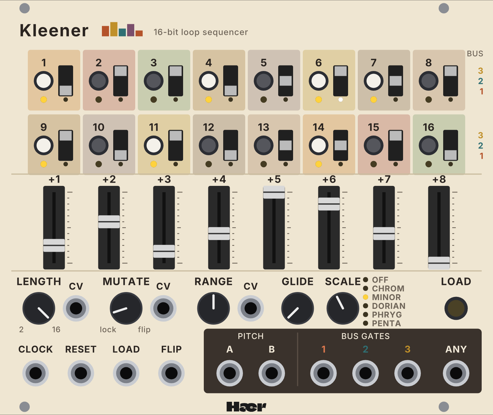

# Kleener

A 16-bit loop sequencer for VCV Rack, inspired by the Klee sequencer. Original design and code; the Klee is credited as the inspiration only.

30 HP. One module, slug `Kleener`, plugin version 2.0.0 (Rack 2).

## The idea in one paragraph

Sixteen on/off **bits** sit in a loop that turns one step on every clock. Eight **pitch-weight sliders** look at the first eight bits of the loop: every slider whose bit is on adds its amount to the pitch. As the loop turns, a different set of bits sits under the sliders, so one short pattern of on/off switches becomes a whole melody. Each step also has a **bus switch** (1, 2 or 3) that sends its gate to one of three gate outputs, so one pattern can play a kick, a hat and a stab at once.

## Controls

| Control | What it does |
|---|---|
| **BIT 1-16** (white buttons) | The pattern. Lit = on. By default a press changes the loop straight away. |
| Amber light under each bit | What is in the loop right now (mutation can make it differ from the buttons). |
| White dot under each bus switch | The playhead. |
| **BUS switch** per step | Down = gate on BUS 1, middle = BUS 2, up = BUS 3. |
| **+1 ... +8 sliders** | Pitch weight of bit 1-8 of the loop window. Full slider = 12 semitones at RANGE 100 %. Tick marks are semitones. |
| **LENGTH** + CV | Loop length, 2-16 steps. +1 V = +1.5 steps. |
| **MUTATE** + CV | Chance that a bit flips as it leaves the playhead. Fully left = locked loop. A little = slowly evolving. Fully right = the loop inverts every pass. +1 V = +10 %. |
| **RANGE** + CV | Scales all sliders together, 0-200 %. Turn down for small intervals, up for leaps. +1 V = +10 %. |
| **GLIDE** | Slide between notes on both pitch outputs (up to about half a second). |
| **SCALE** | Quantiser, root C: OFF, CHROMatic, MINOR, DORIAN, PHRYGian, minor PENTAtonic. The light shows which one is on. |
| **LOAD** (button and jack) | Copies the bit buttons into the loop, undoing any mutation. |
| **CLOCK** | Each rising edge moves the loop one step. |
| **RESET** | Back to step 1 on the next clock, and loads the buttons. |
| **FLIP** | A trigger here makes the next bit flip for sure. |
| **PITCH A** | V/OCT from bits 1-8 of the loop window. |
| **PITCH B** | V/OCT from bits 9-16 (the far half of the loop): a related second line. |
| **BUS GATES 1, 2, 3** | Gate while the clock is high, on steps whose bit is on and whose bus switch points there. |
| **ANY** | Gate on every step whose bit is on. |

### Right-click menu

- **Pitch B reads**: the next 8 bits (default) or the switched-off bits, which makes B the "opposite" of A.
- **Tie gates**: hold a bus gate across neighbouring steps on the same bus, for legato lines.
- **Switches change the loop straight away**: turn off for the classic way, where the buttons are only read on LOAD/RESET. Then you can set up the next pattern while the old one plays and drop it in with LOAD.
- **RESET also loads the switches**.
- **Copy the loop onto the switches**: keep a mutation you like.
- **Random switches**, **Random bus switches**.

## Patch ideas

**1. Detroit bassline with a pulse.** Clock from your master clock at 16ths. PITCH A to a bass oscillator V/OCT, BUS 1 to its envelope. Set SCALE MINOR, RANGE about 40 %, LENGTH 16, MUTATE fully left. Put bus switches to 1 on the steps you want the bass to speak. Turn LENGTH to 12 or 7 against a 16-step drum loop for that rolling, never-quite-repeating Rhythim Is Rhythim feel.

**2. Three drums from one pattern.** BUS 1 to a kick, BUS 2 to a snare/clap, BUS 3 to a hat, ANY to an accent or a filter envelope. Every step whose bit is on plays one of the three. Now nudge MUTATE to about 5-10 %: the groove slowly rewrites itself while keeping its shape. Press LOAD to snap back to the original.

**3. Autechre-style self-mutation.** Patch a slow random or a Marbles-style trigger stream into FLIP, and an LFO into MUTATE CV. Put PITCH A through GLIDE into an FM voice and PITCH B into a second voice an octave up. With "Switches change the loop straight away" off, set a new pattern on the buttons and fire LOAD from a Long Form or bar counter every 8 bars, so the piece moves between sections on its own.

**4. Melody and countermelody.** Set Pitch B to "switched-off bits". A plays whenever B rests and the other way round. Send A to a lead and B to a pad or Just Friends-style voice, both clocked by ANY.

### Starting points

- Sliders: try 3, 7, 2, 5, 12, 10, 5, 0 semitones (the defaults). Sums land on chord tones when SCALE is MINOR.
- Want octaves only: set one slider to full and the rest to 0, RANGE 100 %.
- For acid lines: RANGE 60-80 %, GLIDE about 20 %, Tie gates on.

## Building

GitHub Actions builds the Mac (Apple Silicon) plugin on every push. Branch builds go to the **preview** release; builds from `main` go to **latest**.

Panel: `python3 res/make_panel.py` (needs `pip install fonttools`). Mock-up picture: `python3 tools/preview.py panel-preview.png`.

Licence MIT (see `LICENSE.txt`). Panel font Inter (SIL OFL); maker logo in Climate Crisis (SIL OFL).
